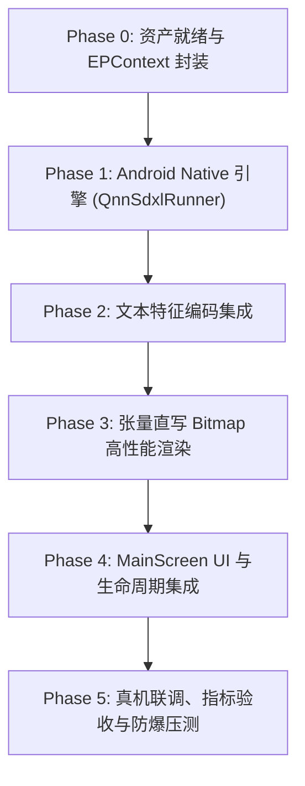

# SDXL on Android NPU (QNN HTP) 实施与开发计划

## 1. 目标与设计原则

在现有的 `whisper-app` Android 应用中新增原生 **「文生图」** 模块（Tab 3），基于高通骁龙 8 Gen 3（SM8650 / HTP v75）实现完全本地化、低延迟的 1024×1024 高清端侧文生图功能。

### 1.1 核心设计约束
1. **纯原生闭环**：不依赖任何 Python 解释器或外部服务，所有模型加载、NPU 算子调用、潜变量调度、图像解码及 UI 渲染全部在 Android App 进程内完成。
2. **异构计算分工**：
   * **UNet（计算大头，2.6B）**：部署至 **Qualcomm HTP (NPU)**，通过 `QnnExecutionProvider` 运行 W8A16 量化 Context Binary，饱和利用 NPU 算力与能效。
   * **VAE Decoder（显存与精度敏感）**：采用轻量级 **TAESDXL**（仅 4.9MB），部署至 **CPU** (`CPUExecutionProvider`)，以 FP32 运行，彻底根绝片上 SRAM (TCM) 溢出并杜绝色斑失真。
   * **调度器（Scheduler）**：采用 4 步极速 **SDXL-Lightning / Turbo** 欧拉调度器，在 Kotlin 层以高精度 Native 浮点数组循环计算。
3. **内存与生命周期管理**：
   * 遵循应用现有 `QnnEpRegistration` 门禁规范，避免多模块重复注册 QNN 导致闪退；
   * 严格实施 **Tab 级按需加载与显存互斥**（切到文生图时释放 STT/LLM 的大权重，切出时释放 UNet 会话，防止整机 OOM）。

---

## 2. 模型契约与技术规范

| 组件 | 模型文件 | 运行硬件 / EP | 输入规格 | 输出规格 | 精度 / 格式 |
| :--- | :--- | :--- | :--- | :--- | :--- |
| **UNet 核心** | `unet.bin` + `unet_ctx.onnx` | Qualcomm HTP<br>`QNNExecutionProvider` | `sample`: `[1, 4, 128, 128]`<br>`timestep`: `[1]`<br>`encoder_hidden_states`: `[1, 77, 2048]`<br>`text_embeds`: `[1, 1280]`<br>`time_ids`: `[1, 6]` | `out_sample`: `[1, 4, 128, 128]` | W8A16 预编译 Context Binary (~2.39 GB) |
| **VAE 解码器** | `taesdxl_decoder.onnx` | CPU<br>`CPUExecutionProvider` | `latent_sample`: `[1, 4, 128, 128]` | `sample`: `[1, 3, 1024, 1024]` | FP32 ONNX 模型 (~4.9 MB) |
| **Text Encoder** | `clip_g_l_text_encoder.onnx` 或<br>轻量 Prompt 编码表 | CPU / HTP | `input_ids`: `[1, 77]` | `hidden_states`: `[1, 77, 2048]`<br>`text_embeds`: `[1, 1280]` | FP16 / INT8 |

---

## 3. 分阶段实施里程碑



### Phase 0: 资产就绪与 EPContext 封装（已完成核心验证）
* [x] **轻量 VAE 验证**：下载并测试 `taesdxl_decoder.onnx`（4.9MB），CPU 验证 1024×1024 解码通过。
* [x] **EPContext 封装脚本**：编写 `tools/sdxl_qnn/build_sdxl_epcontext.py`，生成标准 `unet_ctx.onnx`。
* [ ] **真机权重获取与部署**：
  * 获取针对 Snapdragon 8 Gen 3 (SM8650 / v75 HTP) 编译的 `unet.bin`（约 2.39GB，W8A16）；
  * 通过 ADB 推送至手机存储：
    ```bash
    adb shell mkdir -p /data/data/com.example.whisperapp/files/models/sdxl
    adb push unet.bin /data/data/com.example.whisperapp/files/models/sdxl/
    adb push unet_ctx.onnx /data/data/com.example.whisperapp/files/models/sdxl/
    adb push taesdxl_decoder.onnx /data/data/com.example.whisperapp/files/models/sdxl/
    ```

---

### Phase 1: Native 引擎实现 (`QnnSdxlRunner.kt`)
新建 `app/src/main/java/com/example/whisperapp/qnn/QnnSdxlRunner.kt`，负责核心生命周期与推理编排：
* [ ] **会话双轨初始化**：
  * UNet 会话配置：加载 `libQnnHtp.so`，开启 `burst` 性能模式与 HTP FP16 精度开关；
  * VAE 会话配置：绑定 `CPUExecutionProvider`，设置独立线程池（推荐 4 线程）。
* [ ] **Euler 4 步迭代调度器**：
  * 实现基于 SDXL-Lightning 4 步预置 $\sigma$ 梯度的极简无内存分配调度；
  * 循环中复用 DirectBuffer 避免频繁触发 Android GC。
* [ ] **进度回调接口**：提供 `onProgress(step: Int, total: Int, stepElapsedMs: Long)` 供 UI 实时展示步进进度。

---

### Phase 2: 文本特征编码集成
* [ ] **Prompt 编码策略评估**：
  * **方案 A（初版快速跑通）**：内嵌经典提示词的高维 Embedding 预计算表（如质感人像、科幻城市、写实风光等），快速打通 NPU 生图链路；
  * **方案 B（全功能完整版）**：引入轻量化 OpenCLIP/CLIP 双文本编码器的 ONNX 导出包（约 400MB），在 CPU 上跑一次编码得到 `encoder_hidden_states` [1, 77, 2048] 和 `text_embeds` [1, 1280]。

---

### Phase 3: 张量直写 Bitmap 高性能渲染
* [ ] **零拷贝 / 低开销像素装配**：
  * TAESDXL 输出为 `[1, 3, 1024, 1024]` 的 Float 数组（通道优先 CHW）；
  * 使用并行数组扫描或 NEON 指令集将 `[3, 1024, 1024]` 归一化并打包装入 `IntArray(1024 * 1024)`（ARGB_8888）；
  * 调用 `Bitmap.createBitmap(1024, 1024, Bitmap.Config.ARGB_8888)` 及 `setPixels(...)`；
  * 避免大尺寸位图在 Compose 堆中多次复制。

---

### Phase 4: UI 集成与生命周期管理
* [ ] **修改 `MainScreen.kt`**：
  * `TabRow` 增加第四个 Tab：`Tab(text = { Text("文生图") })`；
  * 切换到文生图时，自动释放 Whisper ASR / LFM3 Chat 的非必要缓存；
  * 切换离开文生图时，释放 UNet 与 VAE 会话，将显存还给系统。
* [ ] **构建 `ImageGenScreen.kt`**：
  * Prompt 输入框 + 常用风格预设 Tag 选择器；
  * 生成按钮（带步进进度动画：`"NPU 去噪中 (2/4 步)..."`）；
  * 原生 `Image(bitmap = generatedBitmap.asImageBitmap())` 预览，支持双击缩放与保存到相册。

---

### Phase 5: 真机联调与验收标准

#### 性能与稳定性验收指标（目标平台：SM8650 / 8 Gen 3）
| 监控项 | 目标指标 | 验收方式 |
| :--- | :--- | :--- |
| **UNet 4 步去噪总耗时** | $\le 2.0$ 秒 | 抓取 Logcat 中每步去噪的 `stepElapsedMs` |
| **TAESDXL CPU 解码耗时** | $\le 1.5$ 秒 | 测量 `vaeSession.run` 及 Bitmap 装配耗时 |
| **端到端出图耗时** | $\le 4.5$ 秒 | 用户点击“生成”至 Compose UI 渲染完成 |
| **峰值内存占用 (RSS)** | $\le 3.5$ GB | `adb shell dumpsys meminfo com.example.whisperapp` |
| **NPU 硬件使用验证** | HTP 命中率 100% | 确认无 CPU Fallback 警告，DSP 功耗正常响应 |
| **UI 交互流畅度** | 60/120 fps 不卡死 | 主线程无 ANR，所有推理与解码在 `Dispatchers.IO` 协程中执行 |

---

## 4. 关键风险与应对预案

1. **多模块同时并发导致的整机 OOM**：
   * *风险*：Whisper Large V3 (2GB) + LFM3 (1.7GB) + SDXL (2.5GB) 同时常驻，系统必杀进程。
   * *预案*：在 `MainScreen.kt` 的 `switchToTab()` 中设置严格的**排他互斥逻辑**，进入文生图前强制触发 `QnnWhisperRealAudioRunner.stop()` 与 `QnnLfmChatRunner.release()`。
2. **NPU 首次推理 Warmup 卡顿**：
   * *预案*：在用户切换至“文生图”Tab 时异步在后台触发 Session 加载，点击“生成”前完成预热。
3. **高通 HTP 调度挂起（DSP Hang）**：
   * *预案*：设置推理超时间隔（如 10 秒超时检测），超时自动释放 Session 并重置状态，避免锁死全局 NPU 驱动。
